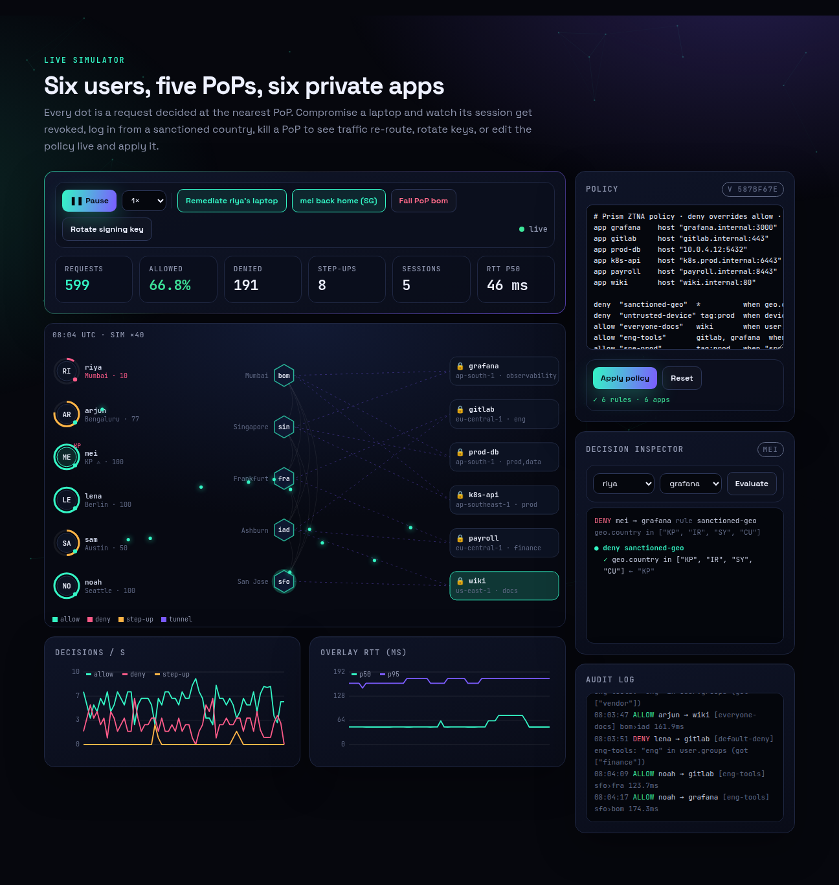
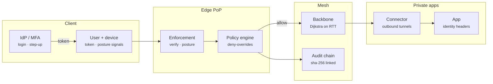
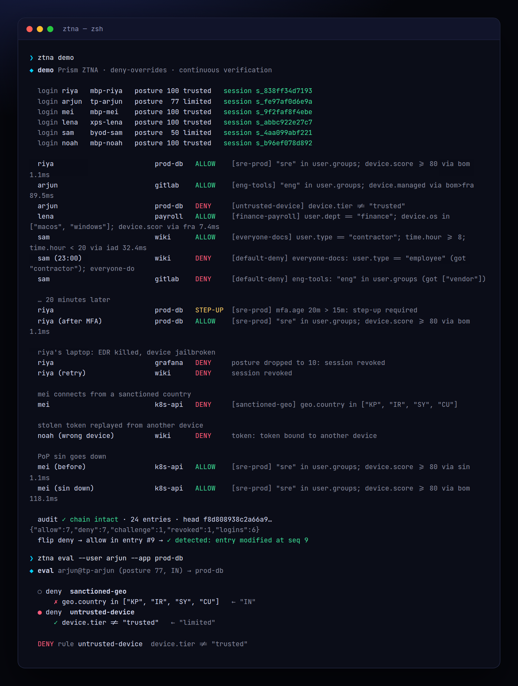
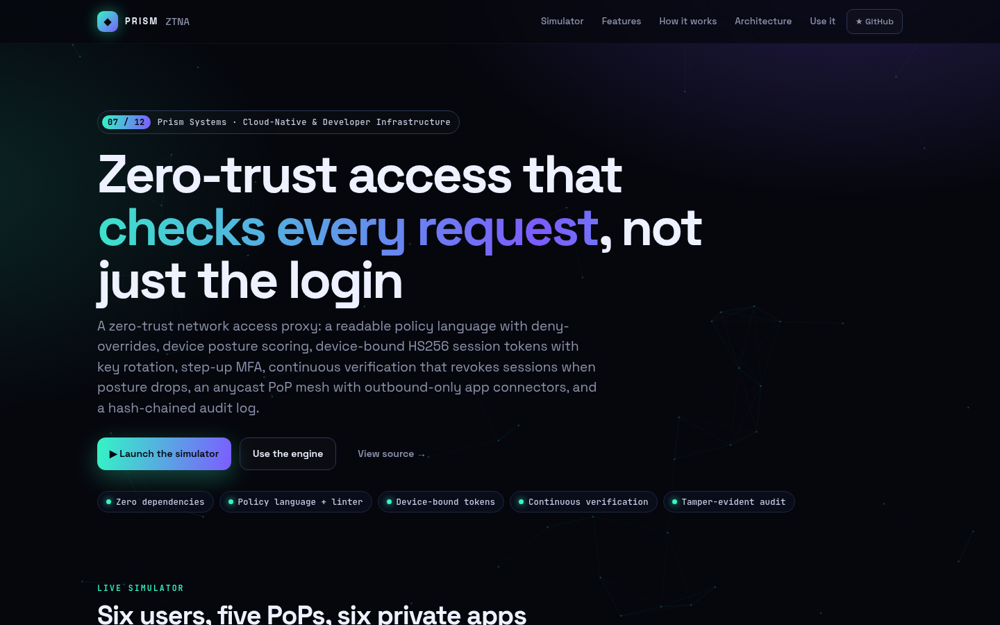
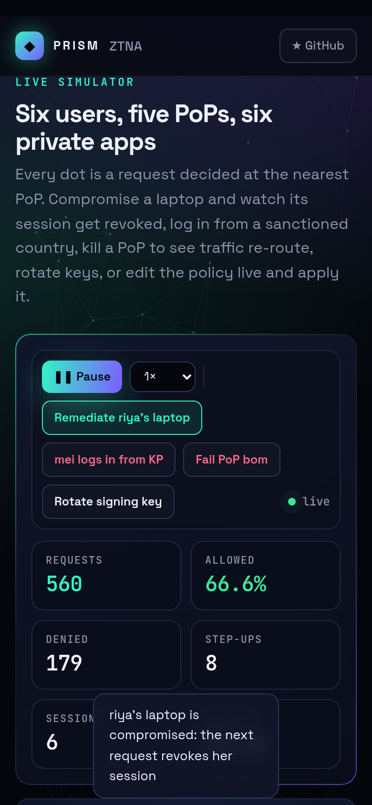

<!-- Prism Systems 07/12 -->
<p align="center">
  
</p>

<p align="center">
  
</p>

<p align="center">
  <a href="https://github.com/krishyaa06/prism-ztna/actions/workflows/ci.yml"></a>
  <a href="https://krishyaa06.github.io/prism-ztna/"></a>
  
  
  
  <a href="LICENSE"></a>
</p>

<p align="center">
  <a href="https://krishyaa06.github.io/prism-ztna/"><b>Live simulator</b></a> ·
  <a href="docs/ARCHITECTURE.md"><b>Architecture</b></a> ·
  <a href="docs/USAGE.md"><b>Docs</b></a> ·
  <a href="#-quick-start"><b>Quick start</b></a>
</p>

<p align="center">
  <a href="https://krishyaa06.github.io/prism-ztna/"></a>
</p>


## ⚡ Overview

A VPN puts you on the network and trusts you from then on. Zero trust asks, for every single request, who you are, what device you are on, whether that device is still healthy, and whether this policy lets that combination reach this app. Prism ZTNA is a compact, readable implementation of that model, the same shape as BeyondCorp, Cloudflare Access or Zscaler Private Access: a policy language you can review in a pull request, explainable decisions, device-bound sessions and a mesh that keeps private apps off the internet.

## ✨ Features

| | Feature | Details |
| :-: | --- | --- |
| ⌘ | **Policy language** | Declare apps with tags, then `allow` / `deny` rules with targets (`*`, names, `tag:prod`) and conditions using `and or not == != < >= in matches`, durations like `15m`, and `require mfa within 15m`. |
| ⚖ | **Deny overrides, default deny** | All matching deny rules are checked first, then the first matching allow wins. Anything else is denied, with the failed conditions of every candidate rule in the reason. |
| ◉ | **Explainable decisions** | The evaluator records each comparison with the value it saw, so every decision shows which rule fired and why (`device.score >= 80 ← 77`). |
| 💻 | **Device posture** | Weighted checks for disk encryption, EDR, patch age (with partial credit), jailbreak, firewall, screen lock and MDM produce a 0–100 score and a trusted / limited / untrusted tier. |
| 🔑 | **Device-bound tokens** | HS256 tokens carry a `cnf.dev` thumbprint, audience and expiry, use constant-time signature checks and reject `alg: none`. Key rotation keeps the previous key for a grace period. |
| ↻ | **Continuous verification** | Posture is re-evaluated on every request. If a device drops below the floor its sessions are revoked immediately, not at the next login. |
| ⬡ | **PoP mesh** | Users anycast to the nearest healthy PoP, traffic crosses a private backbone (Dijkstra on RTT), and app connectors dial out to two PoPs, so private networks need no inbound ports. |
| ⛓ | **Hash-chained audit** | Every login, decision, step-up and revocation commits to the previous entry with SHA-256. Editing any entry breaks the chain at that sequence number. |

## 🏗️ Architecture



### How it works

1. **Authenticate** — The IdP verifies the user. The broker scores the device and refuses login below the posture floor, then signs a token bound to that device.
2. **Verify** — Each request presents the token and device id. Signature, audience, expiry, key id and device binding are checked, and the session must still exist.
3. **Re-check posture** — Device signals are scored again. A compromised device loses its sessions on its next request.
4. **Decide** — The policy sees user, device, geo, time and MFA age. Deny rules first, then allows, then default deny. Step-up rules return a challenge instead of an allow.
5. **Route + audit** — Allowed traffic goes ingress PoP → backbone → egress PoP → connector → app with identity headers. Every outcome lands in the audit chain.

More detail in [docs/ARCHITECTURE.md](docs/ARCHITECTURE.md).

## 🚀 Quick Start

**Try it in the browser:** [https://krishyaa06.github.io/prism-ztna/](https://krishyaa06.github.io/prism-ztna/), no install needed.

```bash
# CLI, no install
npx github:krishyaa06/prism-ztna --help

# add the engine to a project
npm install github:krishyaa06/prism-ztna
```

### JavaScript API

```js
import { Broker, Mesh, Policy, posture } from "prism-ztna";

const policy = `
app prod-db  host "10.0.4.12:5432"  tags [prod]
deny  "geo"      *         when geo.country in ["KP", "IR"]
deny  "posture"  tag:prod  when device.tier != "trusted"
allow "sre"      tag:prod  when "sre" in user.groups and device.score >= 80 require mfa within 15m`;

const zt = new Broker({ policy, directory, mesh: new Mesh({ connectors }) });
const { token, sid } = zt.login("riya", "mbp-riya");          // posture-checked, device-bound token

const d = zt.access(token, "prod-db", { deviceId: "mbp-riya" });
d.effect;   // "allow" | "deny" | "challenge"
d.rule;     // "sre"
d.trace;    // every rule and comparison, with the values it saw
d.route;    // { path: ["bom"], rtt: 1.1 }

zt.stepUp(sid);                       // after WebAuthn / TOTP
zt.revokeDevice("mbp-riya", "lost");  // kill every session on a device
zt.verifyAudit();                     // { ok: true, entries, head }

new Policy(policy).lint();            // unknown targets, unreachable apps, unconditional rules
```

| Export | What it does |
|---|---|
| `new Policy(src)` · `.decide(ctx, app)` · `.lint()` · `.apps` · `.rules` · `.version` | Compile, evaluate and lint a policy |
| `parse(src)` · `tokenize(src)` · `evaluate(node, ctx, trace)` · `PolicyError` (`line`, `col`) | Language internals |
| `posture(device)` · `CHECKS` | Device posture score, tier and failed checks |
| `new Keyring(secret)` · `.rotate()` · `sign(claims, ring)` · `verify(token, ring, { now, device, aud })` · `decode` · `deviceThumb` | Session tokens |
| `new Mesh({ pops, connectors })` · `.route(geo, app)` · `.setPop(id, up)` · `km` · `rttMs` | PoP mesh and routing |
| `new Broker({ policy, directory, mesh, ttl, minScore })` · `login` · `access` · `stepUp` · `revoke` · `revokeDevice` · `explain` · `setPolicy` · `verifyAudit` · `on(fn)` | The access broker |
| `createProxy(broker, { upstreams, adminKey })` from `src/node/proxy.js` | Identity-aware HTTP reverse proxy |

### CLI

```bash
$ npx github:krishyaa06/prism-ztna demo
$ npx github:krishyaa06/prism-ztna lint examples/policy.ztna
$ npx github:krishyaa06/prism-ztna eval --user arjun --app prod-db
$ npx github:krishyaa06/prism-ztna posture
$ npx github:krishyaa06/prism-ztna route --user riya --app gitlab --down fra
$ npx github:krishyaa06/prism-ztna serve --port 8080
```

<p align="center"></p>

| Command | Description |
|---|---|
| `ztna lint [file.ztna]` | Rules table and static warnings |
| `ztna eval [file.ztna] --user --app [--mfa 5m --country IN --hour 14 --device]` | Explain one decision rule by rule |
| `ztna posture [--device id]` | Posture checks and score |
| `ztna route --user --app [--down bom,fra]` | Path through the PoP mesh |
| `ztna token --user` | Issue and decode a session token |
| `ztna demo` | End-to-end scenario with audit verification |
| `ztna serve [--port 8080] [file.ztna]` | Proxy in front of demo apps (`/auth/login`, `/auth/mfa`, `/_audit`, `/_policy`) |

## 📸 Screenshots

<table>
  <tr>
    <td width="68%"></td>
    <td width="32%"></td>
  </tr>
</table>

## 🧠 Design Decisions

- **A language, not JSON.** Policies are code reviewed by humans, so the syntax reads like English (`allow "sre" tag:prod when "sre" in user.groups require mfa within 15m`). A Pratt parser gives correct precedence (`not` > comparisons > `and` > `or`) and errors with line and column.
- **Deny overrides, default deny.** Ordering mistakes cannot open access: a matching deny always wins, and an app with no allow is unreachable. The linter flags both cases.
- **Explanations are first-class.** Comparisons record the value they saw, so a denial says `device.score >= 80 (got 77)` instead of just "forbidden".
- **Posture is not a login-time check.** It is re-scored on every request, and a drop below the floor revokes the session in the same call.
- **Bind tokens to devices.** A copied token is useless from another device because the `cnf.dev` thumbprint will not match.
- **Outbound-only connectors.** Apps never accept inbound connections, so there is nothing to port-scan.

## 🏭 Production Notes

The decision path is complete. A production deployment also needs:

- A real IdP (OIDC) for login and WebAuthn for step-up, plus device attestation (TPM / Secure Enclave keys or mTLS client certificates) instead of a trusted `x-device-id` header.
- Posture signals from MDM / EDR APIs (Intune, Jamf, CrowdStrike) rather than self-reported values.
- Asymmetric tokens (ES256 / EdDSA) with JWKS so PoPs can verify without sharing a secret, and short TTLs with refresh.
- Real tunnels (WireGuard or HTTP/2 CONNECT) between connectors and PoPs, and BGP anycast for ingress.
- Audit entries shipped to append-only storage and periodically anchored (signed checkpoints).

## 📁 Project Structure

```text
prism-ztna/
├── assets/
│   └── logo.svg
├── bin/
│   └── ztna.js
├── css/
│   └── app.css
├── docs/
│   ├── ARCHITECTURE.md
│   └── USAGE.md
├── examples/
│   ├── lint-me.ztna
│   └── policy.ztna
├── js/
│   └── app.js
├── src/
│   ├── lib/
│   │   ├── cli.js
│   │   ├── rng.js
│   │   └── sha256.js
│   ├── node/
│   │   └── proxy.js
│   ├── broker.js
│   ├── demo.js
│   ├── index.js
│   ├── mesh.js
│   ├── policy.js
│   ├── posture.js
│   └── token.js
├── test/
│   └── ztna.test.js
├── .gitignore
├── LICENSE
├── README.md
├── index.html
└── package.json
```

## 🧪 Tests

```bash
npm test
```

The test suite uses the built-in `node:test` runner, so there is nothing to install. CI runs it on Node 20 and 22.

## 🗺️ Roadmap

- [ ] OIDC login + WebAuthn step-up
- [ ] ES256 tokens with JWKS
- [ ] WireGuard connector tunnels
- [ ] Policy unit tests in the DSL

## 🤝 Contributing

1. Fork the repo and create a branch: `git checkout -b feat/my-idea`
2. Make your change in `src/` and add a test in `test/`
3. Run `npm test`, then open a Pull Request

## 🔷 Part of Prism Systems

**Prism ZTNA** is system **07 of 12** in **Prism Systems**, a series of open-source reference implementations of large-scale infrastructure by [Prism Protocol](https://dc.gg/prismprotocol). Each one ships a real engine, a CLI and a live simulator, all with zero dependencies.

## 👤 Author

<table>
  <tr>
    <td align="center">
      <a href="https://github.com/krishyaa06"><br><b>Soumya Bhandare</b></a><br>
      <sub>Founder @ Prism Protocol</sub>
    </td>
    <td>
      <a href="https://dc.gg/prismprotocol"></a><br>
      <a href="https://instagram.com/prism_protocol_"></a><br>
      <a href="https://x.com/krishyaa06"></a>
    </td>
  </tr>
</table>

## 📄 License

Released under the [MIT License](LICENSE).

<p align="center">
  <b>If this helped you learn something, consider giving it a ⭐</b><br>
  <sub>"Build. Create. Compete." · Made with ⚡ by Prism Protocol</sub>
</p>


