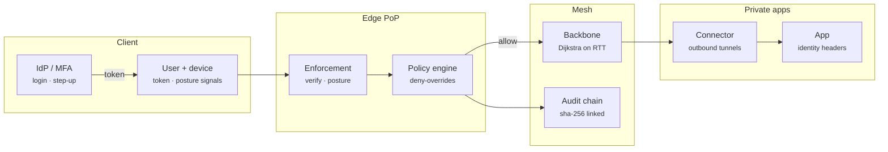

# Prism ZTNA — Architecture

A VPN puts you on the network and trusts you from then on. Zero trust asks, for every single request, who you are, what device you are on, whether that device is still healthy, and whether this policy lets that combination reach this app. Prism ZTNA is a compact, readable implementation of that model, the same shape as BeyondCorp, Cloudflare Access or Zscaler Private Access: a policy language you can review in a pull request, explainable decisions, device-bound sessions and a mesh that keeps private apps off the internet.

## System diagram

## How it works

1. **Authenticate** — The IdP verifies the user. The broker scores the device and refuses login below the posture floor, then signs a token bound to that device.
2. **Verify** — Each request presents the token and device id. Signature, audience, expiry, key id and device binding are checked, and the session must still exist.
3. **Re-check posture** — Device signals are scored again. A compromised device loses its sessions on its next request.
4. **Decide** — The policy sees user, device, geo, time and MFA age. Deny rules first, then allows, then default deny. Step-up rules return a challenge instead of an allow.
5. **Route + audit** — Allowed traffic goes ingress PoP → backbone → egress PoP → connector → app with identity headers. Every outcome lands in the audit chain.

## Design decisions

- **A language, not JSON.** Policies are code reviewed by humans, so the syntax reads like English (`allow "sre" tag:prod when "sre" in user.groups require mfa within 15m`). A Pratt parser gives correct precedence (`not` > comparisons > `and` > `or`) and errors with line and column.
- **Deny overrides, default deny.** Ordering mistakes cannot open access: a matching deny always wins, and an app with no allow is unreachable. The linter flags both cases.
- **Explanations are first-class.** Comparisons record the value they saw, so a denial says `device.score >= 80 (got 77)` instead of just "forbidden".
- **Posture is not a login-time check.** It is re-scored on every request, and a drop below the floor revokes the session in the same call.
- **Bind tokens to devices.** A copied token is useless from another device because the `cnf.dev` thumbprint will not match.
- **Outbound-only connectors.** Apps never accept inbound connections, so there is nothing to port-scan.

## Production notes

The decision path is complete. A production deployment also needs:

- A real IdP (OIDC) for login and WebAuthn for step-up, plus device attestation (TPM / Secure Enclave keys or mTLS client certificates) instead of a trusted `x-device-id` header.
- Posture signals from MDM / EDR APIs (Intune, Jamf, CrowdStrike) rather than self-reported values.
- Asymmetric tokens (ES256 / EdDSA) with JWKS so PoPs can verify without sharing a secret, and short TTLs with refresh.
- Real tunnels (WireGuard or HTTP/2 CONNECT) between connectors and PoPs, and BGP anycast for ingress.
- Audit entries shipped to append-only storage and periodically anchored (signed checkpoints).
